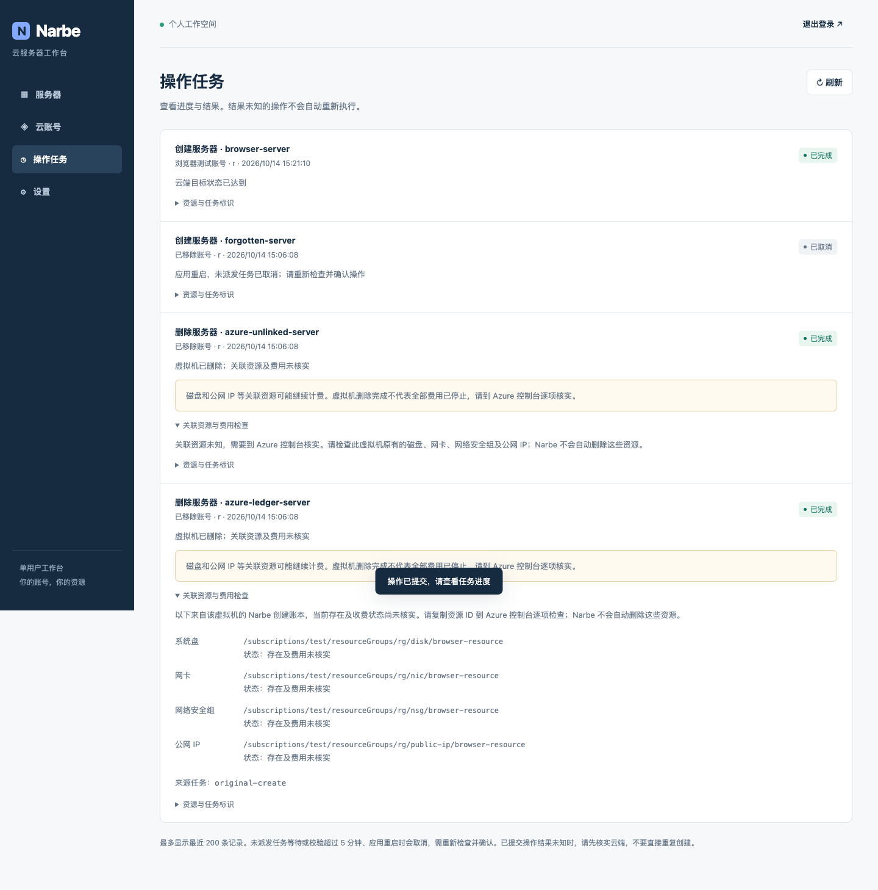

# 正式独立审核修复与回归

日期：2026-10-14（Asia/Shanghai）。项目 Narbe / NARBE-ENG；原 PR #1、原开发分支 `codex/narbe-phase1`；审核基线 `c72b29adf03938617811ea7266a2de5cf5a1ae1d`。

正式审核基线结论由 Project + Product Manager 交付：PASS WITH CONDITIONS，High 1 / Medium 2 / Low 3。本轮只修六项 Finding，保留 Go/SQLite/单容器、四云、单用户架构。没有真实计费创建/删除；没有合并 main 或上线。

## 六项结果

| Finding | 根因 | 实际修复 | 回归结果 |
|---|---|---|---|
| F1 High，Azure 删除账本 | DELETE 返回新的 Operation，覆盖原创建任务的关联资源信息 | 从完整任务表查询同账号创建记录，核验加密意图的 ID/revision/地区、当前 subscription/RG 的完整 Plan/VM/四个关联 ID，及实时 VM 的 narbe-job 标签。删除前保存独立 Ledger，云受理/拒绝/未知及重启都保留；已移除账号仍显示非秘密 provider。未知关联明确提示去控制台核实，未增加依赖删除 | 创建→删除、历史超过200条、错误账号/revision/组/订阅/资源ID/tag/密文/重复来源、落盘前后与未知恢复均通过 |
| F2 Medium，登录全局 DoS | 来源表超过4096就拒绝所有来源 | 容量只约束内存，通过过期清理/淘汰接纳新来源，优先保留已受限来源；仍10分钟8次/来源与2个Argon2id槽 | >4096来源后正确管理员可登录，受限攻击来源仍拒绝；并发容量及哈希槽通过 |
| F3 Medium，旧 queued 自动执行 | 启动只处理running；领取与首次写没有任务年龄保护 | 启动事务取消所有queued、作废旧确认、running→unknown；正常等待/校验最多5分钟，原子领取与实际首次云写前检查期限。未来时间戳保守取消，首次写deadline保留单调时间。已启动Azure多步操作按原context完成，取消重放不复活，新意图需新确认 | 新鲜/陈旧任务重启、正常过期、校验中到期、未来时间戳、取消重放、重新确认、2 Worker与取消竞争、四云HTTP零写检查通过 |
| F4 Low，Windows computerName | 截断15字符可能停在连字符 | 截断后去首尾连字符；空名/全数字提供合法主机名。完整VM资源ID与任务后缀保持原规则 | 14字符、长名第15字符连字符、全连字符、全数字和普通名称的真实VM PUT合同通过 |
| F5 Low，AWS 镜像 | 无名称过滤查询大量官方AMI；AmazonLinux被判other丢弃 | 服务端name OR过滤覆盖既有七家族和常见大小写、正常新AmazonLinux AMI命名；保留owner/地区/架构/可用/废弃/完整分页，拒绝重复游标。AmazonLinux识别展示，未确认维护期仍unknown | 首页空/后续页、Ubuntu/Debian/Windows与AmazonLinux、既有家族过滤、arch过滤未覆盖、重复游标、生命周期unknown通过 |
| F6 Low，Linode 密码 | 只检长度，明显弱口令可入队 | 保留本地12–128字符下限；拦截明显重复/序列/字典词、去装饰和常见替换，不发明官方固定四类要求；API确认与Provider首次写前双层校验，SSH-only省略密码 | 弱词、简单替换、附符号重复、短/长、密码+SSH拒绝；强随机/长短语/SSH-only通过且无密钥泄漏 |

Azure 的四个关联 ID 只代表可信创建账本来源，不证明目前存在或仍计费；UI 所有状态都明确“存在及费用未核实”。删除成功仅表示 VM 删除完成，不表示全部费用已停止。没有可信创建来源时不猜测或回显不可信资源 ID。

## 修复前失败、修复后通过

新增 TestReview 用例先在未修改的 c72b29a 行为上运行，取得如下确定失败（不是只读推测）：

* F1：`Azure delete loses original creation resource ledger`，删除 result 没有原四个 ID。
* F2：第4096个新来源被其他来源容量拒绝，HTTP429。
* F3：已过期创建/删除、重启后 queued 均变 succeeded，云替身写计数1。
* F4：实际 VM PUT computerName 为 `aaaaaaaaaaaaaa-`。
* F5：DescribeImages 没有 name 过滤，四个系统只剩3个，AmazonLinux丢失。
* F6：明显弱密码获得HTTP200确认令牌。

修正后这些用例全部通过。内部复核另外复现了未来 created 获得延长授权、常见替换/附符号弱密码漏网，补充用例先红再绿。所有计数是受控云替身/HTTP transport，不是真实云资源写入。

## 官方约束依据

* [Azure 命名规则](https://learn.microsoft.com/en-us/azure/azure-resource-manager/management/resource-name-rules#microsoftcompute)：Windows computerName 1–15、不能以连字符结尾；Azure资源名比较不区分大小写，资源名与主机名约束分开。
* [AWS DescribeImages](https://docs.aws.amazon.com/AWSEC2/latest/APIReference/API_DescribeImages.html)：名称过滤及分页；未用固定AMI ID或创建日期窗口代替生命周期。
* [Linode创建API](https://techdocs.akamai.com/linode-api/reference/post-linode-instance)：root_pass 7–128字符、服务端强度评分，允许SSH-only，算法/阈值未公开。[官方Cloud Manager实现](https://github.com/linode/manager/blob/6503a875f7a4e82dd8335d4ce16fcbd8ae492e21/packages/manager/src/utilities/validatePassword.ts)使用评分工具。Narbe本地策略不声称完整复刻该评分或保证云端接受，没有新增重型组件或依赖。

## 本轮实际验证

* 完整 `NARBE_BROWSER_TEST=1 go test -race ./... -count=1 -timeout=180s`：通过，含四云HTTP合同、真实SQLite和真实Chrome。
* 浏览器：既有登录/账号/创建/丢响应重试/任务/删除确认/设置/退出，加Azure可信/未知账本、退休账号历史和重启取消原因；无pageerror，桌面/手机流程通过。
* `go vet`、JS语法、Prettier、shell语法、diff whitespace：通过。
* Docker清理CLI替身9/9通过；真实 `scripts/test_install.py` 运行唯一一次本轮多阶段构建、smoke与一键Compose安装，通过；`test_runtime.py` 容器重启/重建密码持久化与非root/只读/日志轮转通过。
* govulncheck v1.9.0源码及从交付镜像提取的真实二进制：0可达漏洞，仍有未调用OpenPGP模块advisory，不宣称全部依赖没有告警。



## 镜像、磁盘与清理

本轮开发前可用约 **38 GiB**，清理后最近回读约 **33 GiB**。共享宿主磁盘会波动，不把整体变化解释为最终镜像体积。Docker库存回读：镜像1、容器0、Volume0、构建缓存0。

最终 `narbe/local:current`：`sha256:6925508dae3c438e93bd8a780998b72fdc471889e252030422a75dbc0c877aff`，压缩内容 **5,365,246 bytes（约5.37 MB）**，实际库存占用 **18.26 MB**，UID65532:65532。

旧镜像 `8ffeb1bc81a7` 在新镜像验证后按确切账本/无引用规则回收；本轮唯一专用Builder及其缓存、smoke、disposable Compose安装/持久化容器/网络/Volume与无引用工具镜像 `51344df7c403` 已清理。未执行全局prune，未触其他项目、正式数据库、账号或持久化数据。必要源码/开发依赖/审查截图保留，原有未跟踪 `.DS_Store` 两份受保护、不提交。

## 内部审查与正式复审

三个只读协作子代理分别核对账本/Windows、限速/任务恢复、AWS/密码，完成范围内内部复核。它们不是原正式 Independent Reviewer，没有用内部结论关闭正式门禁。

```text
本轮 agy Specialist Calls: 1
- Research Scout: 0
- Root-Cause Challenger: 0
- Design Challenger: 0
- Test Designer: 0
- Embedded Reviewer: 1
Embedded Review Calls: 1 total / 0 completed / 1 failed / 0 re-review
```

唯一agy调用：canonical `/Users/wang/bin/agy --agent engineer-specialist`，已固定的 `gemini-3.8-flash-high`（内置high，当前CLI不支持冗余effort参数），inline代码与回归证据、180秒。实际print timeout，未提供结论，不当作代码finding或PASS；没有绕过权限或更改代理。

**正式复审：PENDING，交回 Project + Product Manager 安排原 Independent Reviewer 复核本轮 diff。PR 保持 Draft。** 四云真实账号/计费E2E仍NOT VERIFIED；旧CloudPanel完整功能基线缺口沿用原覆盖矩阵，未在本轮重新开发。
