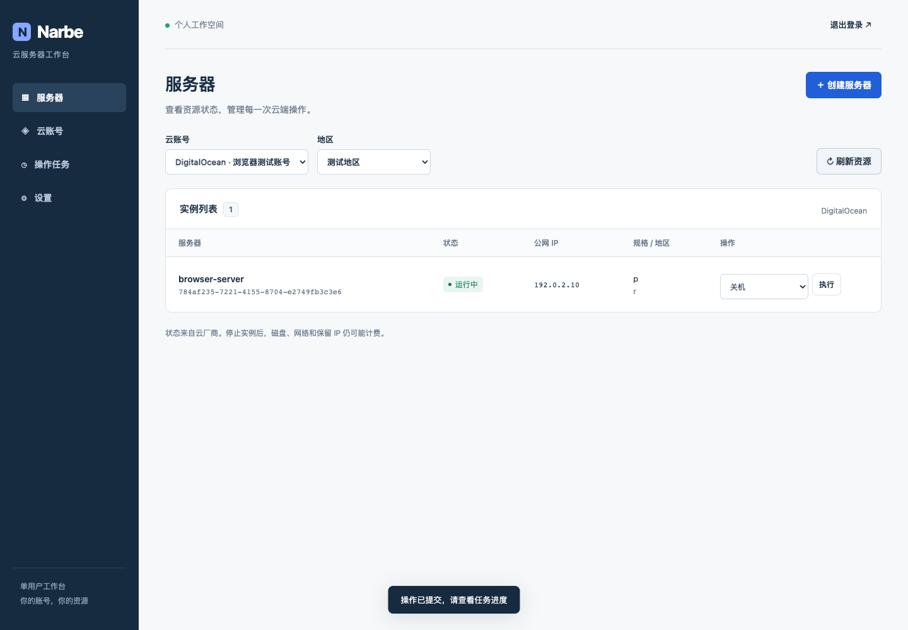
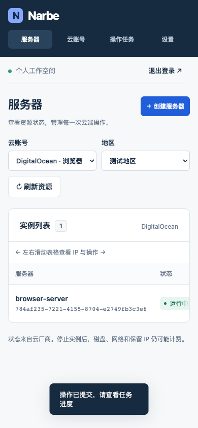
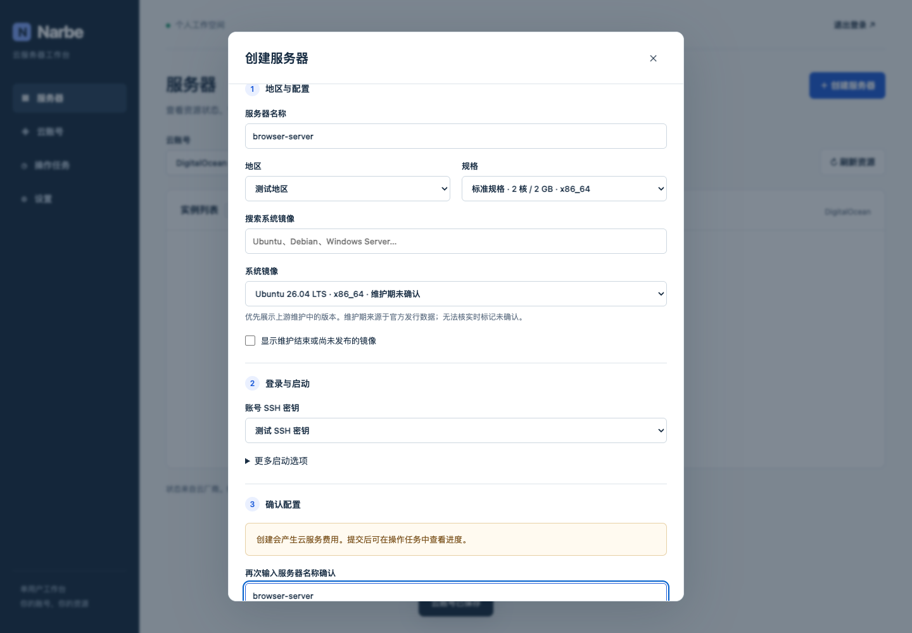

本报告下文记录第一阶段基线 c72b29a 的历史证据。本轮正式审核修复的新证据见 [FORMAL_REVIEW_FIXES.md](FORMAL_REVIEW_FIXES.md)，不能把旧 CI 与镜像证据当作新 diff 的验证。

# 验证与交付证据

验证日期：2026-10-13 至 2026-10-14（Asia/Shanghai）。源码在 `codex/narbe-phase1`；最终提交与 PR 见 Engineer 交付消息及 GitHub。所有真实云计费创建/删除均未执行。

## 已运行

| Evidence 类别 | 命令/检查 | 实际结果 |
|---|---|---|
| Go 单元/HTTP 合同/SQLite 集成 | `NARBE_BROWSER_TEST=1 go test -race ./... -count=1 -timeout=180s` | 通过；四云合同、认证/CSRF、确认、并发、凭据 revision、取消、身份变化、重启不重放、加密/主密钥/锁/持久化 |
| 静态及格式 | `go vet ./...`、gofmt、`node --check`、Prettier、`bash -n scripts/*.sh` | 通过 |
| Docker CLI 故障替身 | `python3 scripts/test_build.py` | 9/9 通过，含失败构建/启动/健康、部分创建、清理失败、查询失败、旧引用/回滚、连续升级及阻止后续构建 |
| 真实浏览器 + 真实 Go/SQLite + Mock 云 | TestBrowser / Playwright + Google Chrome | 登录→接入账号→地区/规格/镜像→创建→任务→资源→删除确认→密码校验→退出；丢失提交响应重试 ID 不变；无 pageerror |
| 浏览器视觉 | 桌面 1440×1000、手机 390×844 | 实际截图检查，无页面水平溢出；移动表格显式提示左右滑动 |
| 真实官方公共只读数据 | `NARBE_LIFECYCLE_LIVE=1 go test ./internal/lifecycle -v` | Ubuntu 24.04 标准维护至2029-05-31、Debian13至2028-08-09、WindowsServer2025至2029-11-13，解析通过。此证据不是云账号 E2E |
| 回归有效性 | 临时错误密码恒通过 / Azure任务后缀固定的定向变异 | 相应测试确实变红，恢复提交源码后变绿 |
| Fuzz | Unseal 约1,997次；Azure资源路径约84,771次 | 通过；没有网络请求 |
| 真实 Docker 一键安装 | `python3 scripts/test_install.py`，调用实际 start.sh/build.sh/Compose | 多阶段构建→临时健康检查→Compose healthy→初始登录/API→安全配置核对通过；使用独立 disposable 项目，已清理 |
| 真实 Docker 持久化 | `python3 scripts/test_runtime.py` | 改密后重启/重建容器均保留新密码，旧 bootstrap 文件不覆盖；非root/只读根FS/日志轮转核对通过；测试Volume已清理 |
| Go 漏洞扫描 | govulncheck v1.9.0，源码与从交付镜像提取二进制 | Go1.26.9，0可达漏洞；1条未调用模块 advisory（OpenPGP弃用），不把模块有告警说成全依赖无漏洞 |
| 依赖安装 | npm lock + `--ignore-scripts` | 安装自带 audit 报告0项；开发依赖不进入生产镜像 |

HTTP 合同和浏览器云替身均为 Mock，不代表真实四云 API 返回成功。实际 Docker 只创建本地验证资源，无云账号。生产二进制没有 mock 或跳过认证开关。

## 已复现并修正的验证问题

* 本机原Go1.26.4标准库漏洞：未用于交付，项目最低版本、CI与镜像统一1.26.9。
* Microsoft Go 默认 systemcrypto 与静态构建冲突：依据官方说明使用 Go 标准密码学实现；真实容器验证通过。
* Docker restart 会重新分配 `127.0.0.1::8080` 的临时宿主端口：测试重新读取实际映射，未用盲目重试写请求掩盖错误。
* 浏览器测试在 httptest server启动后修改 Origin 引起测试配置竞态：改为启动前配置；完整 -race 重跑通过。
* 官方CSV可省略尾部可选字段：真实读取发现后，兼容变长行并加入回归；不会凭云 available 认定维护状态。
* stripped 二进制扫描只能保守判断整个模块：最终保留函数符号（去除DWARF），实际二进制扫描可判断可达性，0可达告警。

## Docker与磁盘

开发前：`df -h .` 可用约 **35 GiB**；Docker 库存为空，镜像/容器/Volume/构建缓存均0。

最终只保留一个经验证的 `narbe/local:current` 镜像：`sha256:8ffeb1bc81a726ccc3c38879ab8e9ef0ad74afc1b3a020296e418bf6d1046a88`；压缩内容 **5,357,725 bytes（约5.36 MB）**，Docker库存实际占用 **18.25 MB**。清理时曾读到约 **33 GiB**，最终再次回读为约 **35 GiB**；宿主共享磁盘会波动，不将其他进程释放空间归因于 Narbe 清理。Docker `.Size` 为压缩内容口径，`docker system df -v` 另给实际占用，不混用。

已回收：本任务各次唯一专用 Buildx Builder 与其缓存、smoke容器、disposable安装/持久化测试容器/网络/Volume、本任务过期镜像657c6efe088a、1912d84186a0，以及无引用的本次专用构建工具镜像51344df7c403。构建源码和 npm 开发依赖为必要交付/复测内容；共享Go工具链/模块缓存没有作全局删除。未清理其他项目资源，未运行全局 prune。

构建/清理日志受本任务测试文件管理，最终摘要存本文；不保留无限增长的调试日志。正式数据库、云账号和持久化生产Volume从未建立或删除。

## 不能声明的结果

* **真实四云 E2E：NOT VERIFIED**，没有账号/逐项计费授权。
* **完整旧版功能覆盖：BLOCKED**，官方旧镜像registry超时，真实UI/API未观察；换IP/定时同步仅有未关联历史线索。
* **正式独立审核：PENDING**，未分配审核者；不以内部审查或扫描替代。
* **合并/上线：未执行**；交付通过 [Draft PR #1](https://github.com/pixingzoudaiyuexing/Narbe/pull/1)。

远端 CI 已对实现提交 `e8d78b76c9769e43fa2f856ea11e691938496986` 实际通过：[Push 检查](https://github.com/pixingzoudaiyuexing/Narbe/actions/runs/38434960337)、[PR 检查](https://github.com/pixingzoudaiyuexing/Narbe/actions/runs/38434961416)。覆盖 Go race/vet、9类清理测试、漏洞扫描、Chromium真实应用流程、Linux amd64 Docker构建与容器持久化。后续提交如果仅更新本报告，新增远端结果在交付消息记录。

## 截图（云数据为测试替身）

